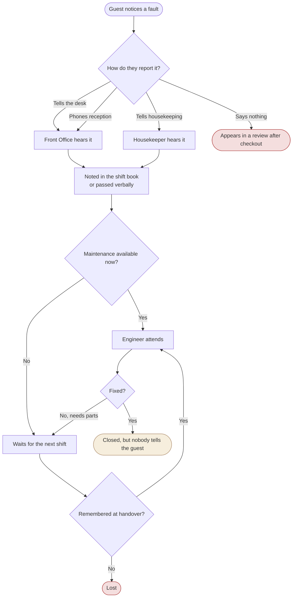
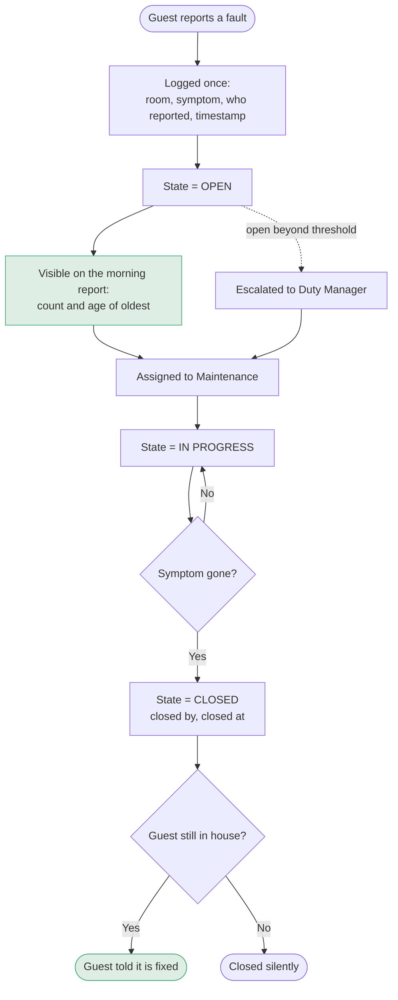
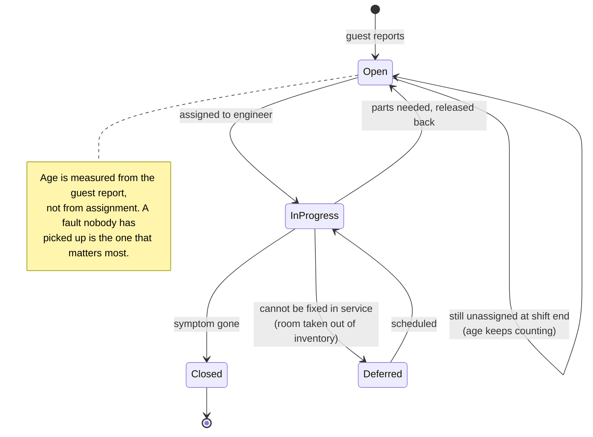
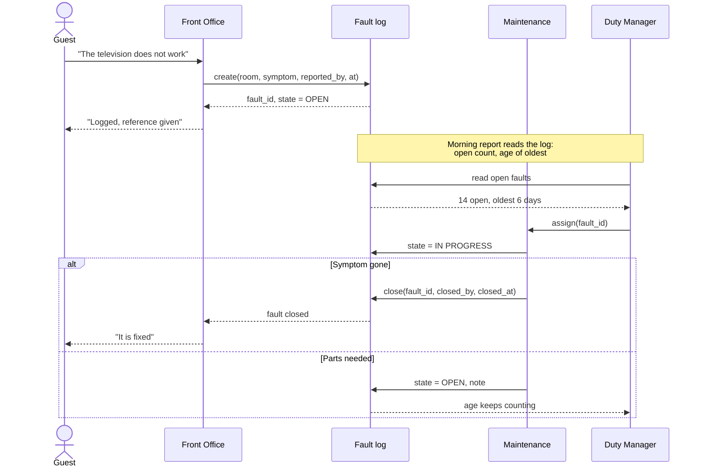
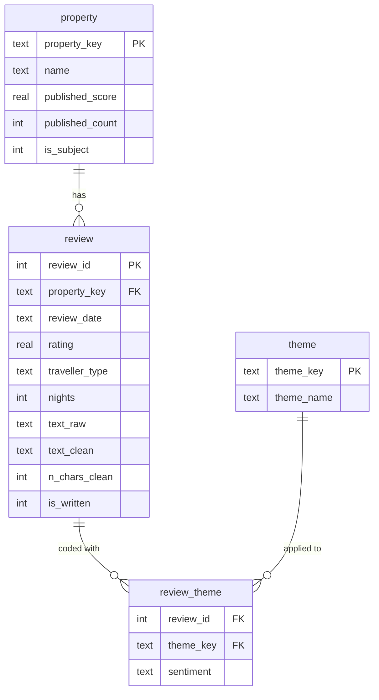

# Process and UML

Companion to [`01-requirements.md`](01-requirements.md). Diagrams are Mermaid, which GitHub
renders in place, so no image files to go stale against the text.

---

## 1. As-is: how a guest-reported fault travels today

Reconstructed from what guests describe in the reviews, not from observation inside the hotel.
It is a hypothesis to be corrected in the first working session, and the point of drawing it
is to have something specific to be corrected.

**Three exits, and two of them are silent.** A fault can end in a review the hotel reads a
week later, or in nothing at all. Even the good exit leaves the guest uninformed, which is
the one a guest can actually observe, and the one they write about.

## 2. To-be: the same journey with a state and an owner

**One change carries the rest.** Every fault has a state, and the open ones are counted where
somebody is already looking. Everything else (assignment, escalation, telling the guest)
becomes possible only because the fault is visibly open.

## 3. Activity diagram: closing a fault

The decision points a Duty Manager actually faces on a shift.

**Age runs from the guest's report, not from assignment.** Measuring from assignment would
make an unassigned fault look young, which is exactly backwards.

## 4. Sequence diagram: the reporting and closing interaction

**The line that does not exist today is the last one.** Every review quoted in section 1 of
the requirements is a guest who never received it.

## 5. Data model behind the analysis

The review corpus that produced the evidence, as built in [`../sql/schema.sql`](../sql/schema.sql).

`review_theme.sentiment` carries `neg` or `pos`. It is the column that lets one query ask
*"how many guests complained about this"* and another ask *"how many reviews mention it at
all"*, without either having to be explained in a caption. The published version of this
analysis put both measures in one table and needed a footnote to separate them.
